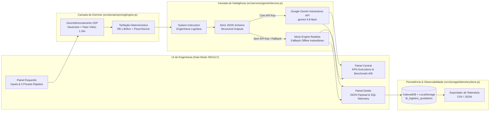

# ⚡ LogiEngine AI — Motor de Precificação Dinâmica, Roteirização e SLA Logístico

> **Arquitetura de Referência para Logística de Última Milha (Last-Mile Delivery)** combinando regras determinísticas de tarifação por quilometragem/volume com inferência preditiva estruturada (**Google Gemini API — Structured Outputs / JSON Schema**) para cálculo de **Surge Pricing**, estimativa de **SLA Dinâmico**, **Classificação de Risco Operacional** e **Alocação de Frota**.

---

## 🎯 1. Objetivo do Sistema

Simuladores tradicionais de frete baseados apenas em CEP e distância linear falham em operações reais de alta frequência (como entregas de refeições e conveniência), pois ignoram **variáveis estocásticas em tempo real**: intempéries severas, retenções arteriais por acidentes e desequilíbrios agudos entre oferta e demanda de entregadores em clusters específicos.

O **LogiEngine AI** resolve esse gargalo operando como um microsserviço híbrido em duas camadas:
1. **Camada Determinística de Domínio**: Garante previsibilidade financeira calculando distância georreferenciada entre CEPs, tarifa fixa de coleta (`R$ 4,50`), taxa quilométrica estrita (`R$ 1,80/km`) e adicional progressivo de peso/volume.
2. **Camada de Inteligência Preditiva (Google Gemini API)**: Avalia o contexto operacional em tempo real e retorna um contrato **JSON Schema estrito** contendo o multiplicador dinâmico (`surge_multiplier`), o SLA ajustado em minutos (`estimated_sla_minutes`), o grau de risco logístico (`risk_level`), os fatores de gargalo (`bottleneck_factors`), a decisão técnica de roteirização (`routing_recommendation`) e a confiança preditiva (`confidence_score`).

---

## 🏗️ 2. Arquitetura Técnica e Módulos



### Estrutura de Diretórios

```text
├── index.html                         # Interface de Engenharia em 3 Painéis (Dark Mode)
├── styles.css                         # Design System Técnico (#0D1117, #161B22, #EA1D2C, #238636)
├── package.json                       # Scripts de execução e suíte de testes automatizados
├── README.md                          # Documentação técnica e contrato da API
├── src/
│   ├── main.js                        # Orquestrador da aplicação, eventos e telemetria
│   ├── domain/
│   │   └── pricingEngine.js           # Regras determinísticas (R$ 1,80/km, peso/volume, CEPs e Presets)
│   ├── services/
│   │   └── geminiService.js           # Integração Google Gemini Interactions API + JSON Schema + Mock Engine
│   ├── storage/
│   │   └── telemetryStore.js          # Persistência IndexedDB/LocalStorage estruturada como tabela SQL
│   └── ui/
│       └── syntaxHighlighter.js       # Syntax Highlighting de JSON e formatadores de moeda/tempo
└── tests/
    └── pricingEngine.test.js          # Testes unitários e validação de contrato JSON Schema
```

> **Nota sobre o Modelo Gemini:** De acordo com as diretrizes atuais do Google Gemini SDK (`v1beta/interactions`), modelos da família `gemini-2.5-*` foram descontinuados em favor do **`gemini-3.8-flash`**. O serviço (`src/services/geminiService.js`) utiliza `gemini-3.8-flash` nas chamadas reais à API e registra a compatibilidade com a especificação no painel de telemetria.

---

## 📜 3. Contrato da API JSON (Structured Outputs)

A chamada à API do Google Gemini (`POST https://generativelanguage.googleapis.com/v1beta/interactions`) embute o `system_instruction` de especialista em malha logística e força o retorno estruturado através da propriedade `response_format` com `mime_type: "application/json"`.

### JSON Schema Estrito (`LOGIENGINE_RESPONSE_JSON_SCHEMA`)

```json
{
  "type": "object",
  "properties": {
    "surge_multiplier": {
      "type": "number",
      "description": "Multiplicador de precificação dinâmica (Surge Pricing) entre 1.0 e 2.5."
    },
    "estimated_sla_minutes": {
      "type": "integer",
      "description": "Tempo total estimado de entrega (SLA) em minutos inteiros."
    },
    "risk_level": {
      "type": "string",
      "enum": ["LOW", "MEDIUM", "HIGH", "CRITICAL"],
      "description": "Classificação de risco operacional e logístico da rota."
    },
    "bottleneck_factors": {
      "type": "array",
      "items": { "type": "string" },
      "description": "Lista de fatores técnicos de gargalo que impactam o SLA e o preço."
    },
    "routing_recommendation": {
      "type": "string",
      "description": "Decisão técnica recomendada para alocação de modal/entregador e despacho."
    },
    "confidence_score": {
      "type": "number",
      "description": "Score de confiança da inferência preditiva entre 0.0 e 1.0."
    }
  },
  "required": [
    "surge_multiplier",
    "estimated_sla_minutes",
    "risk_level",
    "bottleneck_factors",
    "routing_recommendation",
    "confidence_score"
  ]
}
```

### Exemplo de Resposta JSON Retornada pelo Motor (`Cenário Crítico: Tempestade + Sexta à Noite`)

```json
{
  "surge_multiplier": 2.45,
  "estimated_sla_minutes": 66,
  "risk_level": "CRITICAL",
  "bottleneck_factors": [
    "Tempestade severa reduz velocidade média da frota em ~38% e eleva risco de alagamento",
    "Retenção crítica por Acidente na Via no corredor Itaim Bibi / Vila Olímpia - SP -> Pinheiros / Vila Madalena - SP",
    "Escassez Crítica de entregadores ativos no cluster Itaim Bibi / Vila Olímpia - SP (+10 min no pareamento)"
  ],
  "routing_recommendation": "DESPACHO PRIORITÁRIO NÍVEL 1: Bloquear pedido duplo (No-Batching), expandir raio de busca para 3.5km, ativar bônus dinâmico imediato para Motofrete Experiente (Score > 4.8) e redirecionar rota evitando vias arteriais bloqueadas.",
  "confidence_score": 0.76
}
```

---

## 🗄️ 4. Persistência Local Estruturada (`tb_logistics_quotations`)

Todas as cotações processadas são salvas automaticamente no **IndexedDB** (`LogiEngineAI_TelemetryDB`) com espelhamento síncrono no **LocalStorage**, modeladas segundo a tabela relacional abaixo:

| Coluna | Tipo SQL | Descrição |
| :--- | :--- | :--- |
| `transaction_id` | `UUID PRIMARY KEY` | Identificador único da cotação gerada (`crypto.randomUUID()`) |
| `created_at` | `TIMESTAMP` | Data/hora ISO-8601 exata da execução |
| `origin_cep` / `destination_cep` | `VARCHAR(9)` | CEPs de coleta e entrega |
| `distance_km` | `DECIMAL(5,2)` | Distância considerada na rota (km) |
| `static_price_brl` | `DECIMAL(8,2)` | Valor base determinístico (sem IA) |
| `dynamic_price_brl` | `DECIMAL(8,2)` | Valor final com Surge Pricing (`Base × Surge Multiplier`) |
| `surge_multiplier` | `DECIMAL(4,2)` | Multiplicador retornado pela IA (`1.0` a `2.5`) |
| `estimated_sla_minutes` | `INT` | SLA preditivo final em minutos |
| `risk_level` | `VARCHAR(16)` | `LOW`, `MEDIUM`, `HIGH` ou `CRITICAL` |
| `latency_ms` | `INT` | Latência de inferência medida em milissegundos (`ms`) |
| `ai_response_payload` | `JSONB` | Objeto JSON bruto completo retornado pelo LLM |

Você pode clicar em qualquer linha da tabela na aba **"Metrics & Logs"** para re-inspecionar o payload daquela execução ou clicar em **"Exportar CSV"** / **"Exportar JSON"** para baixar os logs completos.

---

## 🚀 5. Como Rodar o Projeto

### Pré-requisitos
- Qualquer navegador moderno (Chrome, Edge, Firefox, Safari) e opcionalmente **Node.js 18+** para rodar o servidor local ou a suíte de testes automatizados.

### Opção 1: Servidor Local via Node/NPX (Recomendado)

No terminal, na raiz do projeto:

```bash
# Iniciar servidor HTTP na porta 3000
npm start
```
Em seguida, acesse `http://localhost:3000` no navegador.

*(Alternativamente, você pode usar a extensão **Live Server** do VS Code ou `python -m http.server 3000`).*

### Opção 2: Executar a Suíte de Testes Unitários

Para validar a matemática determinística (`R$ 1,80/km`), o cálculo geográfico por CEP e a conformidade estrita do JSON Schema:

```bash
npm test
```

### Modo Simulação Realista (Mock) vs Modo Live Gemini API
- **Sem chave de API (Zero-Config):** Basta abrir a aplicação e clicar nos **3 Presets Rápidos** ou em **"Executar Motor de Precificação & SLA"**. O motor executa automaticamente no modo de Simulação Realista calibrado.
- **Com Google Gemini API Key:** Insira sua chave `AIza...` no campo seguro do cabeçalho superior. O indicador mudará para **verde (`Google Gemini API Conectada — Live Mode`)** e todas as cotações farão chamadas reais à API do Gemini com validação de JSON Schema.
